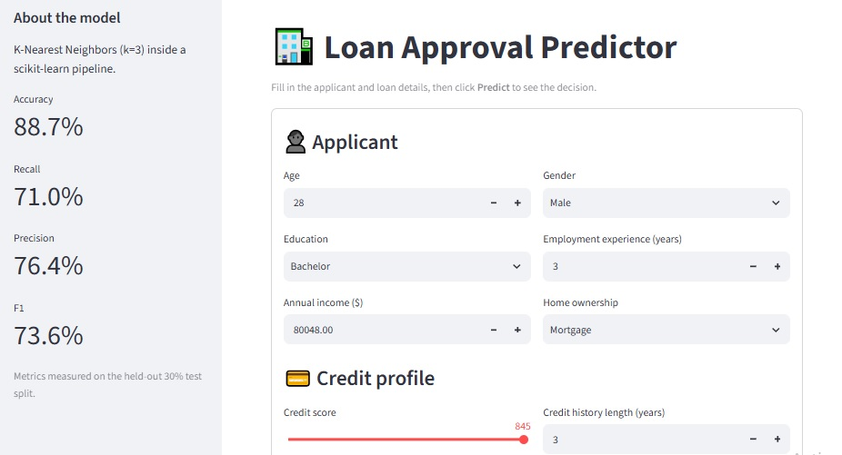
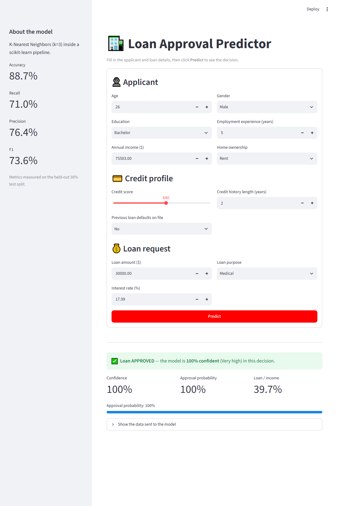
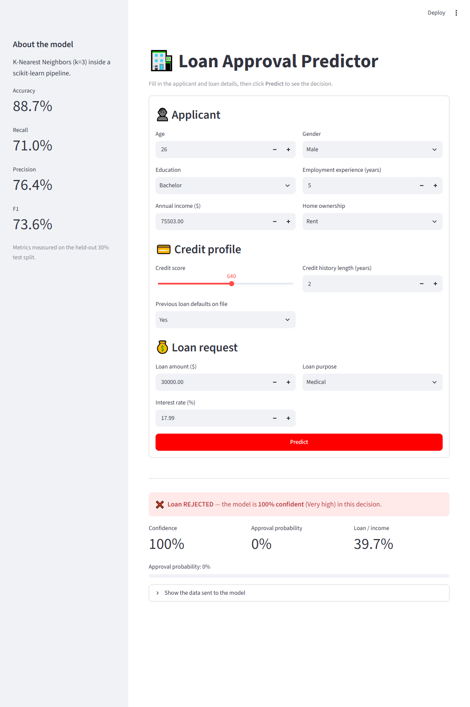

# 🏦 Loan Approval Prediction

A machine-learning project that predicts whether a loan application will be **approved or rejected**, with a **confidence level** for each decision. It covers exploratory data analysis (EDA), model training, and a Streamlit web app.



## Table of contents

1. [Project overview](#project-overview)
2. [Project structure](#project-structure)
3. [Dataset](#dataset)
4. [Methodology](#methodology)
5. [Model and results](#model-and-results)
6. [The Streamlit app](#the-streamlit-app)
7. [How confidence is computed](#how-confidence-is-computed)
8. [Installation and usage](#installation-and-usage)
9. [Limitations and next steps](#limitations-and-next-steps)

## Project overview

| Item | Description |
|---|---|
| Goal | Binary classification: `loan_status` (1 = approved, 0 = rejected) |
| Model | K-Nearest Neighbors (k = 3) in a scikit-learn `Pipeline` |
| Interface | Streamlit form that returns a decision and a confidence level |
| Environment | One shared virtual environment, `.venv` (Python 3.12) |

## Project structure

```text
loanaproval/
├── app.py                        # Streamlit user interface
├── loan-aproval-eda(1).ipynb     # EDA, preprocessing, training, pipeline export
├── data/loan_data.csv            # Dataset (45,000 rows)
├── docs/                         # App screenshots used in this README
├── models/loan_pipeline.joblib   # Saved pipeline + metadata used by the app
├── requirements.txt              # Pinned dependencies of .venv
├── .vscode/settings.json         # Points VS Code to .venv
└── README.md
```

## Dataset

Kaggle: [taweilo/loan-approval-classification-data](https://www.kaggle.com/datasets/taweilo/loan-approval-classification-data), 45,000 applications with 13 features and the target `loan_status`.

| Feature | Type | Meaning |
|---|---|---|
| `person_age` | numeric | Applicant age (years) |
| `person_gender` | categorical | `female` / `male` |
| `person_education` | categorical | High School, Associate, Bachelor, Master, Doctorate |
| `person_income` | numeric | Annual income |
| `person_emp_exp` | numeric | Years of employment experience |
| `person_home_ownership` | categorical | RENT, OWN, MORTGAGE, OTHER |
| `loan_amnt` | numeric | Requested loan amount |
| `loan_intent` | categorical | Purpose: EDUCATION, MEDICAL, VENTURE, PERSONAL, HOMEIMPROVEMENT, DEBTCONSOLIDATION |
| `loan_int_rate` | numeric | Interest rate (%) |
| `loan_percent_income` | numeric | Loan amount divided by income |
| `cb_person_cred_hist_length` | numeric | Credit history length (years) |
| `credit_score` | numeric | Credit score (390–850) |
| `previous_loan_defaults_on_file` | categorical | `Yes` / `No` |
| `loan_status` | target | 1 = approved, 0 = rejected |

## Methodology

The notebook `loan-aproval-eda(1).ipynb` follows these stages:

1. **Loading and inspection**: `info()`, `describe()`, value counts, missing-value check.
2. **Type handling**: categorical columns are detected and cast to `category`.
3. **Outlier analysis**: IQR rule (`Q1 − 1.5·IQR`, `Q3 + 1.5·IQR`) applied to every numeric column.
4. **Visualisation** (Plotly): histogram, box plots, density contour, scatter plot, bar chart, pie chart.
5. **Encoding experiments**: `LabelEncoder` and `OneHotEncoder`.
6. **Scaling experiments**: `MinMaxScaler` and `StandardScaler`.
7. **Baseline KNN**: 70/30 train/test split (`random_state=42`), accuracy, recall, precision, F1, confusion matrix and classification report.
8. **Final pipeline** (last two cells): preprocessing and model combined in one `Pipeline` and exported with `joblib`.

### The exported pipeline

```text
ColumnTransformer (OrdinalEncoder on categorical columns, numeric passthrough)
   → MinMaxScaler
   → KNeighborsClassifier(n_neighbors=3)
```

All steps are fitted **on the training split only**, so no test data leaks into scaling. The input is the raw 13-column DataFrame, so the app needs no extra preprocessing.

`models/loan_pipeline.joblib` is a dictionary:

| Key | Content |
|---|---|
| `pipeline` | The fitted scikit-learn pipeline |
| `feature_columns` | Required input columns, in order |
| `categorical_options` | Allowed values per categorical column (used for the form dropdowns) |
| `numeric_ranges` | `[min, max, median]` per numeric column (used for form defaults) |
| `metrics` | Test-set accuracy, recall, precision and F1 |

## Model and results

Test-set performance (30% hold-out):

| Metric | Value |
|---|---|
| Accuracy | 88.7% |
| Precision | 76.4% |
| Recall | 71.0% |
| F1 | 73.6% |

## The Streamlit app

### Screenshots

Example applicant: 26 years old, Bachelor's degree, income $75,503, renting, requesting a $30,000 medical loan at 17.99%.

**Approved** (no previous defaults on file):



**Rejected** (same applicant, previous default on file = Yes):



### How it works

[app.py](app.py) loads `models/loan_pipeline.joblib` and shows a form with three sections:

- **Applicant**: age, gender, education, employment experience, income, home ownership.
- **Credit profile**: credit score, credit history length, previous defaults.
- **Loan request**: amount, purpose, interest rate.

`loan_percent_income` is computed automatically as `loan amount / income`. After clicking **Predict**, the app shows:

- a green **APPROVED** or red **REJECTED** message that includes the confidence level, for example *"Loan REJECTED — the model is 67% confident (Moderate) in this decision."*;
- metrics for confidence, approval probability and loan-to-income ratio;
- a warning when the loan-to-income ratio is above anything seen in the training data;
- an expandable view of the exact row sent to the model.

The sidebar shows the model's test metrics.

## How confidence is computed

Confidence is `predict_proba` of the **predicted class**, i.e. the share of the 3 nearest neighbours that voted for that class. With k = 3 it can only be 33%, 67% or 100%; since the predicted class is the majority, it is in practice 67% or 100%. Labels: ≥ 90% *Very high*, ≥ 70% *High*, ≥ 55% *Moderate*, otherwise *Low*.

This is a neighbour-agreement score, not a calibrated probability.

## Installation and usage

Everything runs through the single project environment `.venv` (Python 3.12).

### Setup (only if `.venv` is missing)

```powershell
python -m venv .venv
.\.venv\Scripts\python.exe -m pip install -r requirements.txt
.\.venv\Scripts\python.exe -m ipykernel install --user --name loanaproval-venv --display-name "Python (loanaproval .venv)"
```

### Run the notebook (rebuilds `models/loan_pipeline.joblib`)

```powershell
.\.venv\Scripts\python.exe -m jupyter nbconvert --to notebook --execute --inplace "loan-aproval-eda(1).ipynb"
```

The notebook reads `data/loan_data.csv` and uses the `Python (loanaproval .venv)` kernel.

### Run the Streamlit app

```powershell
.\.venv\Scripts\streamlit run app.py
```

Then open http://localhost:8501.

## Limitations and next steps

- KNN confidence is coarse (k = 3); a larger k or a model with calibrated probabilities (e.g. logistic regression, gradient boosting) would give finer confidence values.
- Gender is a feature of the dataset; using it in real lending decisions raises fairness and legal concerns.
- The dataset contains some unrealistic values (e.g. ages above 100), and the model is trained on one snapshot of data.
- Predictions are decision support only, not a final credit decision.
